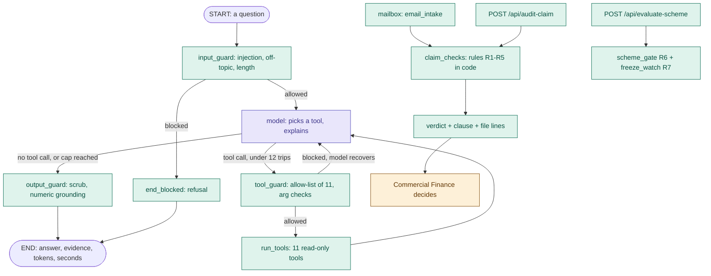

# Architecture note: Sankalp

Stack: FastAPI and SQLite behind JWT login; static Next.js front end served by the same app; LangGraph for the workflow; `openai/gpt-4o-mini-2024-07-18` through OpenRouter (swapped in one file, `agent/llm.py`). Code: `backend/agent/`.

## Graph

Rendered versions: `deliverables/excalidraw/exports/` (system, multi-agent, workflow, recovery, sequence). Three routes. **Ask** (`graph.py`): the guarded loop, at most 12 model-and-tool trips, then a plain answer naming the tools already run. **Intake** (`claims_graph.py`): classify intent, gather fields, validate, check against data, store; the model only words the reply and falls back to a deterministic draft. **Claims and scheme checks:** the mailbox reader and both APIs call code only, so a verdict never depends on a prompt.

## Code and model

| Step | Code or model | Why |
|---|---|---|
| Clean the seven CSVs (`clean.py`) | Code | Repeats, code fixes and snapshot sums must be exact; ties to the QBR |
| Claim rules R1 to R5 (`claim_checks.py`) | Code | Money decision; each rule is policy text, cites the clause, has a test; `test_rules.py` fails if a rule appears elsewhere |
| Scheme order gate R6, freeze watch R7, sizing, cover, FEFO, cap (`analysis.py`) | Code | Arithmetic must reproduce on request; each figure is pinned to the ledger |
| Read a mailbox message into fields (`email_intake.py`) | Code | Fixed layout; instruction lines such as "pre-approved" are dropped, never read as orders |
| Choose which tool answers a question | Model (gpt-4o-mini) | Free text maps to 11 tools; a small, cheap model is enough because it never decides |
| Explain a tool result in plain words | Model | Reading and wording, not deciding; output must match tool numbers |
| Approve a credit note | Person | The verdict is a recommendation; nothing is credited automatically |

## Tools and the data each reads

| Tool | Reads |
|---|---|
| `lookup_batch` | `batch_master.csv` (663 rows; batches from Oct 2023 only) |
| `validate_claim` | claim checker over `expiry_claims.csv`, `primary_sales.csv`, `batch_master.csv` |
| `get_at_risk_stock` | `cnf_stock_snapshot.csv`, latest month-end; also freeze watch R7 |
| `check_scheme_eligibility` | `primary_sales.csv`, `expiry_claims.csv` (flags for a person, never "eligible") |
| `detect_quarter_spike` | `primary_sales.csv` (last 9 days of each quarter) |
| `get_fill_rate` | `primary_sales.csv` (ordered against invoiced) |
| `get_stockist_summary` | `stockist_master.csv`, `expiry_claims.csv`, `primary_sales.csv` |
| `get_stock_cover` | `cnf_stock_snapshot.csv`, `primary_sales.csv` |
| `get_dispatch_quality` | `primary_sales.csv`, `batch_master.csv` (FEFO, shelf life) |
| `get_scheme_cap` | `primary_sales.csv` (free goods against the 3% cap) |
| `get_recovery_summary` | recovery view over claims, sales, batch master (claim back, hold, or needs a person) |

Every tool returns an `interpretation` sentence the model must quote, after a live test showed the model misreading a key.

## Failure handling

| Failure | Handling |
|---|---|
| Prompt injection in a question | Input guard blocks it before the model; guardrail tests |
| Injection in a mailbox message | Instruction lines dropped; the claim is judged on its fields |
| Unknown tool, bad or oversized arguments, loop | Tool allow-list and argument checks; 12-trip cap, then a plain "I stopped" answer |
| Missing or unreadable data (date, batch, stockist, quantity) | NEEDS A PERSON with the reason; never a guess or an approval |
| Batch older than the batch master | Tier T4 "cannot be checked" (971 claims, INR 85.5 L) |
| Model unreachable, slow or key missing | 30 s timeout, one retry; Intake falls back to the deterministic draft; claim and scheme routes are unaffected |
| Model answer drifts from tool data | `ungrounded_figures` flags any number not in a tool result and adds a visible caveat; paths and keys scrubbed |
| Abuse | JWT and role on every route; rate limits on login, ask and demo; CORS restricted; public demo is read-only, never admin; no passwords in source |

Verification: 298 tests pass; 20-record check set 20 of 20; independent recompute from the CSVs 23 of 23. The check set is a regression check (13 records come from the data the rules were built on), and the answers are a draft until Neha Bansal signs them. Not measured: live tool-selection accuracy, and the grounding check is numeric, so it cannot catch a wrong conclusion drawn from correct numbers.

## Cost per run

| Run | Tokens | Time | Cost |
|---|---|---|---|
| Question, 1 tool (2 model calls), two measured runs | 4,459 in and 492 out; 4,009 in and 248 out | 9.1 s; 6.3 s | About INR 0.07 to 0.09 (estimate) |
| Question at the 12-trip cap (worst case, extrapolated) | about 55,000 in and 6,000 out | about 60 s | About INR 1 |
| Claim check, scheme check, mailbox | none | under 1 s | none |

Tokens and seconds are measured; the rupee figure uses assumed prices in `config.py` (USD 0.15 and 0.60 per million tokens, INR 90 per USD) and must be confirmed. About INR 80 a month at 1,000 questions. Cold start is about 6 s (4,503 claims reprocess).

At 10x volume the first breaks are the per-process rate limiter (use a shared store), model spend capped only per minute (add a daily cap), and the cold-start batch (precompute). Not yet tested: Vercel itself (SQLite in `/tmp`, bundle size). A page reload signs the user out by design.
